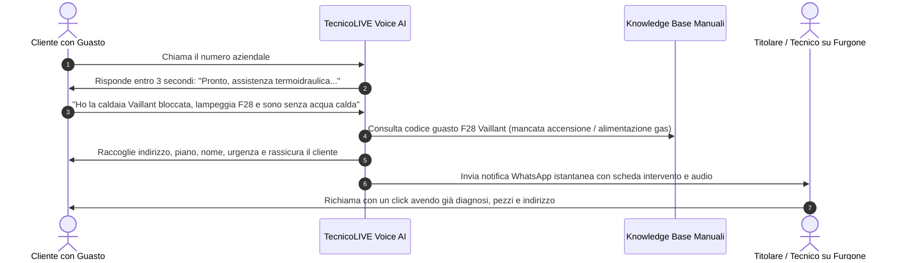

# Scheda Tecnica di Prodotto — TecnicoLIVE Voice AI

**Piattaforma di Intelligenza Artificiale Vocale Verticale per Impianti Termoidraulici, Elettrici e HVAC**

---

## 1. Architettura Tecnologica e Prestazioni

- **Latenza di Risposta Conversazionale**: Sub-600ms (latenza da conversazione umana naturale, senza pause metalliche o silenzi imbarazzanti).
- **Comprensione del Linguaggio Naturale (NLU) Verticale**: Addestramento su oltre 400 termini tecnici dell'impiantistica italiana, comprensione di toponomastica locale (quartieri e comuni siciliani) e inflessioni dialettali.
- **Consultazione Istantanea Manuali Tecnici**:
  - Collegamento diretto a librerie tecniche e codici errore dei principali costruttori: **Buderus, Vaillant, Baxi, Bosch, Ariston, Beretta, Ferroli**.
  - In fase di chiamata l'IA chiede: *"Che marca è la caldaia? Sul display compare qualche codice come F28 o E01?"*
- **Canalizzazione Multi-Chiamata**: Fino a 10 chiamate in ingresso simultanee per numero aziendale (zero segnale di occupato, zero telefonate deviate al silenzio).
- **Operatività H24/7**: Risposta continua di notte, la domenica, nei festivi e durante le ferie estive con gestione delle sole emergenze calde.

---

## 2. Flusso Operativo della Chiamata e Integrazione WhatsApp



---

## 3. Scheda Intervento Inviata su WhatsApp al Tecnico

Ogni chiamata ricevuta dall'assistente vocale genera un messaggio WhatsApp strutturato nel formato:

```text
🚨 NUOVO INTERVENTO QUALIFICATO — TECNICOLIVE
━━━━━━━━━━━━━━━━━━━━━━━━━━━━
👤 Cliente: Mario Rossi
📞 Telefono: +39 347 1234567 (clicca per richiamare)
📍 Indirizzo: Via Garibaldi 42, Acireale (CT)
🔧 Impianto: Caldaia Vaillant EcoTec Plus
⚠️ Guasto / Errore: Codice F28 (Mancata accensione fiamma)
⏰ Urgenza: Alta (famiglia con neonato senza riscaldamento)
📝 Note AI: Il cliente ha verificato la pressione (1.2 bar). Consigliato controllo valvola gas o elettrodo accensione.
━━━━━━━━━━━━━━━━━━━━━━━━━━━━
👉 Ascolta registrazione audio: [Link Audio Crittografato]
```
