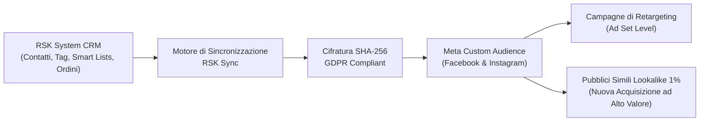
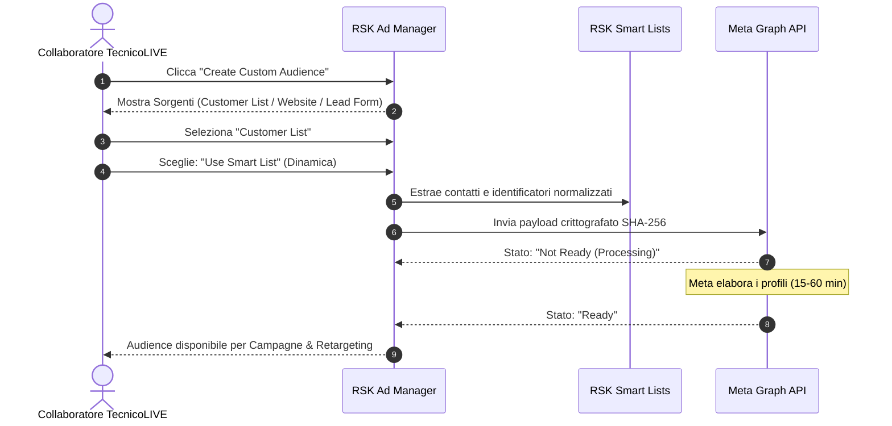
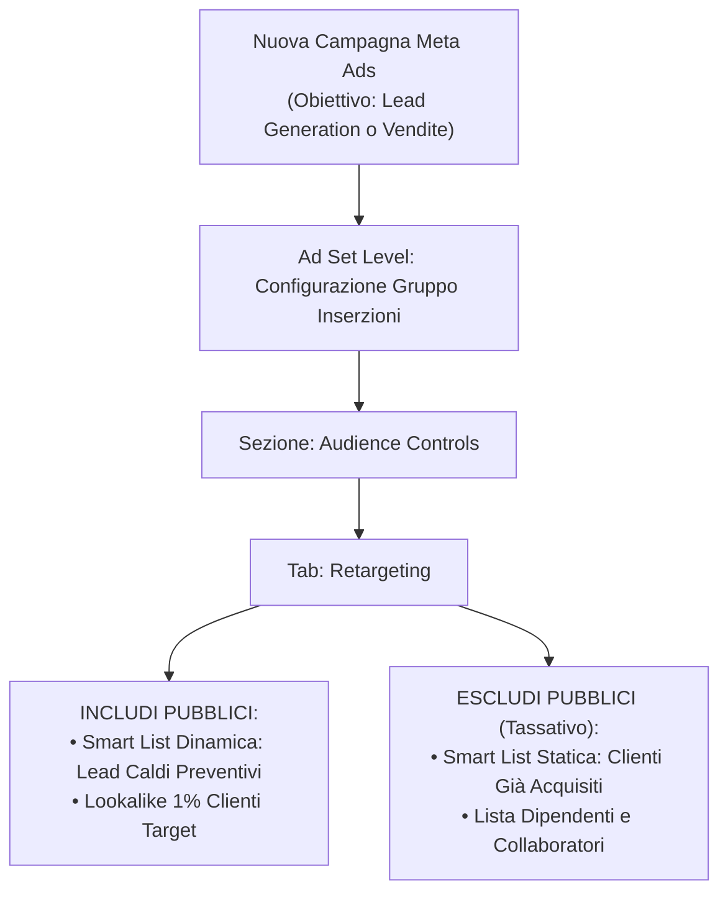

# RSK System — Meta Ads & Targeting con Liste Clienti

**Guida Operativa dalla A alla Z: Creazione, Sincronizzazione Smart Lists e Campagne di Retargeting Sovrane con Pubblici Personalizzati e Lookalike**  
*RSK System Holding © 2026 // Documento Ufficiale ad Uso Operativo TecnicoLIVE*  
*Standard: EU AI Act Compliant • GDPR Validated • ISO/IEC 27001 Aligned*

---

## 1. Perché le Liste Clienti sono la Risorsa più Preziosa su Meta Ads

Nel panorama pubblicitario contemporaneo, dominato dalla progressiva scomparsa dei cookie di terze parti e dalle restrizioni sul tracciamento mobile (iOS 14.5+, privacy sandbox), fare affidamento esclusivamente sul Pixel tradizionale produce costi di acquisizione sempre più elevati e dati parziali.

La soluzione più redditizia e solida consiste nello sfruttare i **dati di prima parte (First-Party Data)**: le informazioni che l'azienda possiede già all'interno del proprio CRM sovrano — email, numeri di telefono, storico acquisti, stato trattative e comportamenti d'acquisto verificati.

Con il modulo **Marketing > Ad Manager** di RSK System, trasformiamo qualsiasi segmento del CRM in una **Customer List Custom Audience (Pubblico Personalizzato da Lista Clienti)** su Facebook e Instagram, con sincronizzazione istantanea o dinamica continua.

---

## 2. Cassetta degli Attrezzi: Strumenti e Configurazione

| Strumento | Ruolo Operativo | Dove si Configura in RSK System |
|---|---|---|
| **Piattaforma RSK System** | CRM, segmentazione contatti, gestione campagne e automazioni di sincronizzazione. | Modulo *Contacts* e modulo *Marketing > Ad Manager*. |
| **Meta Business Manager & Pagina FB/IG** | L'infrastruttura di proprietà Meta a cui appartiene la pagina aziendale TecnicoLIVE e il profilo Instagram. | `business.facebook.com` |
| **Account Pubblicitario Meta (Ad Account)** | L'account pubblicitario con metodo di pagamento attivo su cui vengono erogate e scalate le inserzioni. | Sezione *Account pubblicitari* di Meta Business Manager. |
| **Accettazione Termini Pubblici Personalizzati** | Termini di servizio obbligatori per legge di Meta (*Customer List Custom Audience Terms*). | `facebook.com/ads/manage/customaudiences/tos` |
| **Database Contatti (First-Party Data)** | Dati anagrafici dei clienti o lead: email, telefono, nome, cognome, città, CAP. | Già presenti nel CRM RSK System oppure in file `.csv`. |

---

## 3. Fase 1: Prerequisiti e Collegamento Tecnico

### 1. Connessione dell'Integrazione Meta
1. Accedi a RSK System nel sub-account aziendale di TecnicoLIVE.
2. Vai su **Settings > Integrations**.
3. Clicca su **Connect** nel riquadro *Facebook / Instagram* e completa l'autenticazione con l'account amministratore di Meta Business Suite.
4. Seleziona la Pagina Facebook aziendale e l'Account Pubblicitario corrispondente.

### 2. Impostazione dell'Account Predefinito in Ad Manager
1. Spostati su **Marketing > Ad Manager**.
2. Clicca sull'icona ingranaggio **Ad Manager Settings**.
3. Nella scheda **General**, imposta la Pagina Facebook e l'Account Pubblicitario come predefiniti per tutte le nuove campagne.

### 3. Accettazione dei Termini di Servizio Meta (TOS)
> [!CAUTION]
> Se non hai mai caricato una lista clienti sull'account pubblicitario, Meta bloccherà qualsiasi creazione di Custom Audience finché l'amministratore dell'Ad Account non avrà formalmente accettato i **Termini per i Pubblici Personalizzati da File Clienti** al link ufficiale: `facebook.com/ads/manage/customaudiences/tos`.

---

## 4. Fase 2: Preparazione e Segmentazione nel CRM (Smart Lists)

La qualità del targeting dipende direttamente dalla precisione con cui sono organizzati i contatti in RSK System.

### Standard di Qualità dei Dati per Match Rate > 75-80%
Quando si caricano o sincronizzano dati con Meta, l'algoritmo effettua una comparazione crittografica (hashing SHA-256) tra i dati del CRM e i profili registrati su Facebook/Instagram:
- **Email**: Normalizzate in minuscolo, senza spazi vuoti iniziali o finali (es. `info@ditta-termoidraulica.it`).
- **Telefono**: Obbligatorio il prefisso internazionale **E.164** (es. per l'Italia `+393331234567`). RSK System permette di normalizzarli massivamente prima della sincronizzazione.
- **Nome e Cognome**: In campi rigorosamente separati.
- **Paese e CAP**: Valorizzare sempre il campo Paese con il codice ISO a 2 lettere (`IT` per l'Italia) e il CAP a 5 cifre.

### Creazione di una Smart List Efficace
1. Vai su **Contacts > Smart Lists**.
2. Clicca su **More Filters** e imposta le regole:
   - *Segmento Lead Caldi / Preventivo Inviato*: `Tag` contiene `Lead`, `Pipeline Stage` uguale a `Preventivo Inviato`, `Last Activity` precedente a 30 giorni fa.
   - *Segmento Clienti Attivi (Da Escludere)*: `Tag` contiene `Cliente Attivo` (fondamentale per non sprecare budget pubblicitario).
   - *Segmento Non Associati CNA*: `Tag` contiene `Target Tesseramento CNA`.
3. Clicca su **Save as Smart List** e assegna una nomenclatura standard:  
   `[AUDIENCE] Lead Non Convertiti Q1` oppure `[AUDIENCE] Clienti Attivi 2026`.

---

## 5. Fase 3: Creazione della Customer List Custom Audience

In RSK System la lista pubblico si crea da **Ad Manager Settings > Meta Audiences** (consigliato per organizzare i pubblici con calma) o direttamente nel flusso dell'Ad Set.

### Opzione A: "Use Smart List" (Metodo Consigliato)
1. In **Marketing > Ad Manager > Ad Manager Settings > Meta Audiences**, clicca su **Create a Custom Audience**.
2. Seleziona sorgente **Customer List** e poi **Use Smart List**.
3. Seleziona la Smart List dal menu a tendina.
4. **Configura le Advanced Conditions (Bivio Fondamentale)**:
   - **No, only include the contacts currently on the Smart List (Statica)**: Foto istantanea fissa. Ideale per promozioni temporanee chiuse.
   - **Yes, include the dynamic updates (Dinamica) — IL SUPERPOTERE DI RSK SYSTEM**: Collegamento continuo. Ogni volta che un contatto entra nella Smart List (es. compilando un form o ricevendo un tag da workflow), viene aggiunto all'audience su Meta. Se esce, viene rimosso in automatico. Ideale per funnel perpetui.
5. Assegna il nome (es. `Meta Audience - Lead Caldi Dinamica`) e clicca su **Create Audience**.

### Opzione B: "CSV Upload" (Caricamento da File Esterno)
1. Seleziona **Upload File**.
2. Carica il `.csv` con colonne minime: `email`, `phone`, `first_name`, `last_name`, `country`.
3. Controlla mappatura e conferma con **Create Audience** (cifratura locale SHA-256 automatica conforme al GDPR).

---

## 6. Fase 4: Moltiplicare i Risultati con le Lookalike Audiences

Creata la lista dei migliori contatti, si chiede all'algoritmo di Meta di trovare decine di migliaia di profili simili in Italia:
1. In **Ad Manager Settings > Meta Audiences**, clicca su **Create Audience > Lookalike Audience**.
2. Seleziona la **Source Audience** (la Customer List appena creata).
3. Seleziona la Location (`Italy`).
4. **Scegli la percentuale di somiglianza**:
   - **1% (Raccomandato per iniziare)**: 300.000–350.000 persone in Italia con massima affinità. Più alto tasso di conversione su traffico freddo.
   - **2%–3%**: Per scalare il budget quando la frequenza dell'1% satura.
   - **5%–10%**: Per campagne mass-market o brand awareness pura.
5. Clicca su **Create Audience** (elaborazione da 6 a 24 ore su Meta).

---

## 7. Fase 5: Configurazione del Targeting nella Campagna Meta

### Procedura Operativa:
1. Vai su **Marketing > Ad Manager > Campaigns** e clicca su **Create Campaign**.
2. Scegli l'obiettivo (es. *Lead Generation* o *Sales*).
3. A livello di **Ad Set**, scorri fino a **Audience Controls**.
4. Clicca sul tab **Retargeting** e in *Select Retargeting Audience* scegli la Customer List creata.
5. **Strategia delle Esclusioni (Fondamentale)**:
   - Clicca su **Exclude Audience**.
   - Seleziona la lista `Clienti Già Acquisiti`.
   - *Risultato*: Zero sprechi di budget su chi ha già acquistato TecnicoLIVE.
6. *Nota tecnica*: RSK System consente di combinare fino a 15 audience di retargeting contemporaneamente nello stesso Ad Set.

---

## 8. I 4 Modelli Strategici Pronti all'Uso per TecnicoLIVE

### Scenario 1: Retargeting Diretto su Lead "Preventivo Inviato"
- **Targeting**: Includi Smart List Dinamica `Preventivo Inviato ma Non Confermato`.
- **Escludi**: Smart List `Clienti Chiusi Vinti`.
- **Creatività**: Video dimostrativo dell'assistente vocale che prenota su WhatsApp, garanzia soddisfatti o rimborsati, convenzione CNA Catania con quota 1° anno scontata.
- **Obiettivo**: Chiudere trattative aperte con budget minimo (poche decine di euro su pubblico caldissimo).

### Scenario 2: Upsell & Cross-Sell su Clienti Esistenti
- **Targeting**: Includi Smart List `Acquirenti Piano Starter`.
- **Escludi**: Smart List `Acquirenti Piano Pro / Enterprise`.
- **Creatività**: Annuncio su manuali tecnici avanzati (Buderus, Bosch, Vaillant) e gestione multi-tecnico.
- **Obiettivo**: Aumentare il Customer Lifetime Value (LTV) senza costi di nuova acquisizione.

### Scenario 3: Acquisizione Fredda Scalabile tramite Lookalike 1%
- **Targeting**: Includi Lookalike 1% generata dal top 20% delle aziende impiantistiche censite.
- **Escludi**: Tutte le liste clienti e contatti già presenti nel CRM RSK System.
- **Creatività**: Annuncio educativo (*"Quante chiamate perdi mentre hai le mani sotto la caldaia?"*), audio reale dell'IA, guida gratuita Bollino Blu CITEL Sicilia.
- **Obiettivo**: Generare lead qualificati B2B al minor costo per contatto.

### Scenario 4: Riattivazione Contatti Dormienti
- **Targeting**: Includi Smart List `Lead Nessuna Attività da 180 Giorni`.
- **Creatività**: *"Ti sei perso la nuova convenzione CNA Catania? Attiva la prova gratuita di 7 giorni con la quota del 1° anno agevolata."*
- **Obiettivo**: Riaccendere contatti fermi senza investire su traffico freddo.

---

## 9. Risoluzione dei Problemi Frequenti (Troubleshooting)

| Sintomo Riscontrato | Causa Principale | Soluzione Immediata |
|---|---|---|
| **L'audience creata non è selezionabile nella campagna** | Lo stato è ancora in *Processing / Not Ready*. | Meta richiede da 15 a 60 minuti. Attendere lo stato **Ready** in *Meta Audiences*. |
| **Errore: "Customer List Terms Not Accepted"** | Mancata accettazione dei TOS obbligatori di Meta. | Accedere con l'utente amministratore a `facebook.com/ads/manage/customaudiences/tos` e cliccare **Accetta**. |
| **Match Rate troppo basso (< 50%)** | Formattazione incompleta di telefoni o email. | Verificare che i telefoni abbiano il prefisso `+39` (E.164) e le email siano minuscole senza spazi. |
| **Errore di caricamento file CSV** | Intestazioni di colonna errate o formattazione invalida. | Esportare in UTF-8 con intestazioni canoniche (`email`, `phone`, `first_name`, `last_name`, `country`). |
| **La campagna non eroga impression** | Dimensione pubblico inferiore alla soglia minima Meta. | Meta richiede **almeno 100 contatti profilati attivi**. Unire segmenti contigui o ampliare la finestra temporale. |

---

## 10. Checklist Operativa Finale (Pre-Lancio)

Prima di lanciare qualsiasi campagna su RSK System, spuntare formalmente ciascuna voce:
- [ ] L'account Meta e l'Ad Account sono correttamente connessi in **Settings > Integrations**.
- [ ] I termini *Meta Custom Audience Terms of Service* sono stati formalmente accettati.
- [ ] La Smart List nel CRM contiene solo contatti normalizzati (email minuscole, telefoni con prefisso `+39`).
- [ ] L'audience in Ad Manager è stata impostata come **Dinamica** per aggiornamenti automatici.
- [ ] Lo stato dell'audience nella scheda *Meta Audiences* risulta **Ready**.
- [ ] Nel gruppo inserzioni (Ad Set) è stata impostata l'**esclusione categorica dei clienti già acquisiti**.
- [ ] Il budget e le creatività (copy, formati grafici, video demo) sono allineati alla consapevolezza del target (caldo vs freddo).
