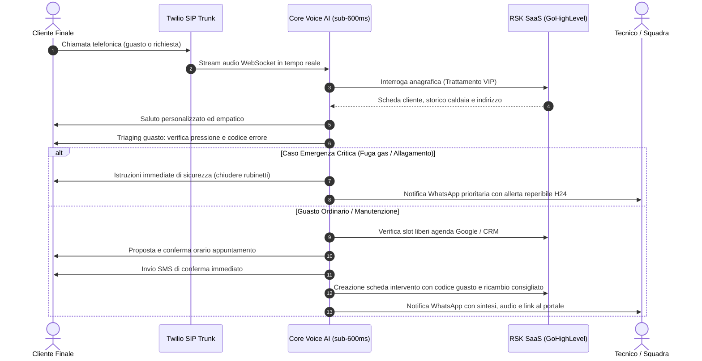

# ⚙️ KB-02: Prodotto, Tecnologia Vocale & Architettura Full Stack
### Specifiche Tecniche, Flusso di Chiamata sub-600ms e Sicurezza Industriale

---

## 1. Schema Architetturale Full Stack (Master Blueprint v2.4)
L'architettura di TecnicoLIVE è costruita secondo principi industriali di **disaccoppiamento, zero-single-point-of-failure e latenza minima (<600ms)**:

```
┌─────────────────────────────────────────────────────────────────────────────┐
│                       CHIAMANTE TELEFONICO (CLIENTE)                        │
└──────────────────────────────────────┬──────────────────────────────────────┘
                                       │ (Chiamata voce su numero geografico o deviazione)
                                       ▼
┌─────────────────────────────────────────────────────────────────────────────┐
│                     TELEPHONY & VOICE ENGINE (TWILIO)                       │
│    - Ricezione SIP Trunking / WebRTC                                        │
│    - Trasferimento di Chiamata Trasparente (Zero Hardware da Installare)    │
└──────────────────────────────────────┬──────────────────────────────────────┘
                                       │ (Audio Stream bidirezionale WebSocket)
                                       ▼
┌─────────────────────────────────────────────────────────────────────────────┐
│                 INTELLIGENZA ARTIFICIALE VOCALE CONVERSAZIONALE             │
│    - Speech-To-Text ad altissima accuratezza e tolleranza rumori            │
│    - Core LLM con RAG Tecnico (Manuali Caldaie & Clima indicizzati)         │
│    - Text-To-Speech Neurale sub-600ms con flessioni vocali realistiche      │
└──────────────────────────────────────┬──────────────────────────────────────┘
                                       │ (Eventi JSON & Webhooks)
                                       ▼
┌─────────────────────────────────────────────────────────────────────────────┐
│                RSK ORCHESTRATION ENGINE (Next.js 15 + Cloudflare)           │
│    - Frontend: Next.js App Router, Tailwind CSS, Componenti Interattivi     │
│    - Edge Layer: Cloudflare Workers per routing geografico & White-Label    │
│    - FinTech Hub: Stripe Connect + Stripe Issuing per automazione SaaS      │
└──────────────────┬───────────────────────────────────────┬──────────────────┘
                   │                                       │
                   ▼                                       ▼
┌──────────────────────────────────────┐┌─────────────────────────────────────┐
│         RSK MCP ENGINE v2.0          ││      SaaS BACKEND (GoHighLevel)     │
│ - Model Context Protocol Server      ││ - Multi-Tenant Subaccount Dedicati  │
│ - Hard-Lock Location ID (Sicurezza)  ││ - Pipeline Opportunità e Contratti  │
│ - Accesso Diretto + 550 Operazioni   ││ - Calendari & Slot Orari Sincroniz. │
│ - Note, Task, Deals, SMS, WhatsApp   ││ - White-Label su portale.tecnicolive│
└──────────────────────────────────────┘└─────────────────────────────────────┘
```

---

## 2. Dettaglio dei Componenti dell'Infrastruttura

### 2.1 Telephony Layer (Twilio SIP & WebRTC)
- **Zero Hardware:** L'impiantista non deve installare apparecchiature fisiche, modem dedicati o linee telefoniche fisse. Mantiene il suo numero di cellulare o fisso storico e attiva un inoltro di chiamata standard.
- **Supporto Chiamate Simultanee:** L'infrastruttura Twilio gestisce picchi simultanei illimitati: se 20 clienti chiamano contemporaneamente durante una gelata, 20 istanze AI rispondono nello stesso istante senza alcun segnale di occupato.

### 2.2 Pipeline AI Vocale Neurale (Streaming sub-600ms)
- **Streaming Bidirezionale WebSocket:** L'audio del chiamante viene inviato a blocchi streaming, trascritto (STT) ed elaborato in tempo reale.
- **Latenza sub-600ms:** Elimina i silenzi imbarazzanti tipici dei vecchi bot (1.5-2.0s), consentendo un'interazione naturale con pause umane e micro-flessioni espressive.
- **Tolleranza Rumore & Comprensione Dialettale:** Il modello comprende parlati con rumori di fondo (furgoni in transito, acqua che scorre, attrezzi da lavoro), accenti regionali italiani marcati e persone anziane agitate per un blocco caldaia.
- **Clonazione Vocale Neurale (Voice Cloning):** Nel Piano Business ed Enterprise, addestriamo modelli proprietari per replicare fedelmente la voce reale del titolare dell'azienda.

### 2.3 Edge Layer & FinTech Provisioning
- **Cloudflare Workers:** Distribuiscono le risorse statiche e dinamiche ai nodi Edge con latenza di rete minima, gestendo le regole di reindirizzamento e white-label.
- **FinTech Hub (Stripe Connect & Stripe Issuing - "The God Engine"):** Gestisce la monetizzazione SaaS automatica, il rinnovo degli abbonamenti e il provisioning dei sub-account senza attrito umano né ritardi operativi.

### 2.4 RSK MCP Server v2.0 & Sicurezza Multi-Tenant
- **Model Context Protocol (MCP):** Server nativo che interfaccia gli agenti AI con oltre 550 operazioni gestionali per creare contatti, note d'intervento, opportunità, appuntamenti e trigger WhatsApp.
- **Hard-Lock Location ID:** Ogni azienda impiantistica possiede una partizione dati totalmente isolata (`Location ID`). Nessun dato cliente, anagrafica o trascrizione può entrare in contatto con account terzi, garantendo piena conformità al GDPR e agli standard bancari.

---

## 3. Il Flusso Operativo Completo della Chiamata



---

## 4. Portale SaaS Dedicato: [portale.tecnicolive.it](https://portale.tecnicolive.it) (Area Riservata Clienti Abbonati)
> [!IMPORTANT]
> **Modalità di Accesso:** Il portale [portale.tecnicolive.it](https://portale.tecnicolive.it) non è una pagina pubblica di vendita, ma la **web application gestionale riservata** a cui si accede **esclusivamente dopo aver sottoscritto un abbonamento**, inserendo le credenziali personali di login generate durante la fase di onboarding assistito. Chi non è ancora cliente naviga su [www.tecnicolive.it](https://www.tecnicolive.it) per scoprire il prodotto, calcolare il ROI o richiedere una demo.

Una volta effettuato il login, l'installatore o la segreteria possono:
1. **Riascolto Chiamate:** Player audio streaming con timeline interattiva e trascrizione sincronizzata.
2. **Scheda Tecnica Guasto:** Modello caldaia/condizionatore, codice errore rilevato (es. *F28 Vaillant*), pressione impianto dichiarata.
3. **Calendario & Squadre:** Controllo orari, assegnazione interventi ai furgoni e gestione ferie/festivi.
4. **Analisi Metriche:** Statistiche sulle chiamate ricevute per fascia oraria, tasso di conversione in appuntamenti e chiamate fuori orario salvate.
